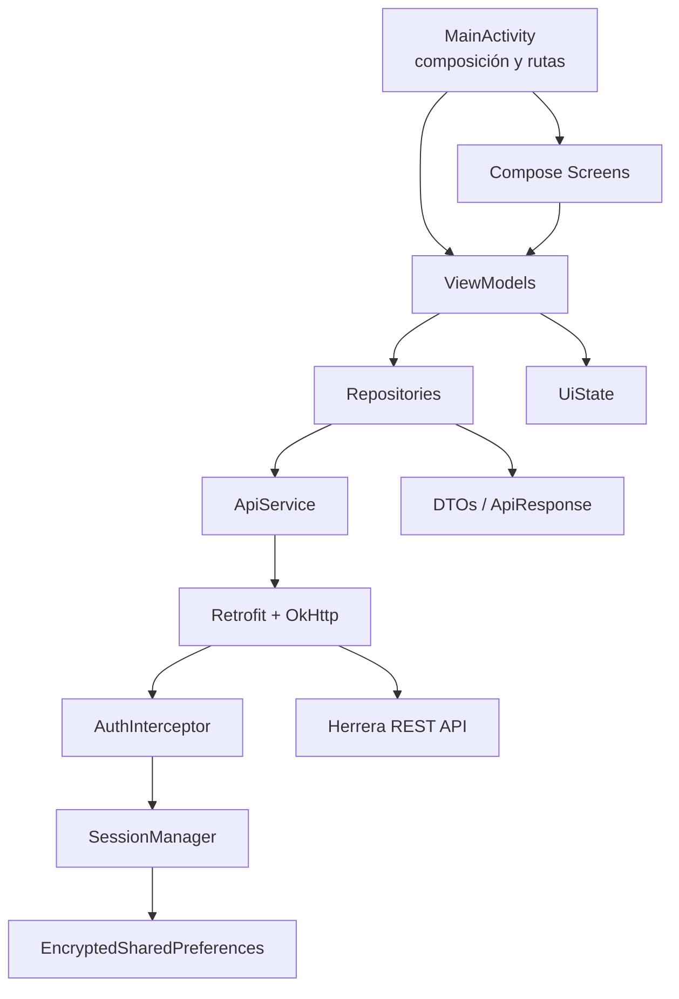
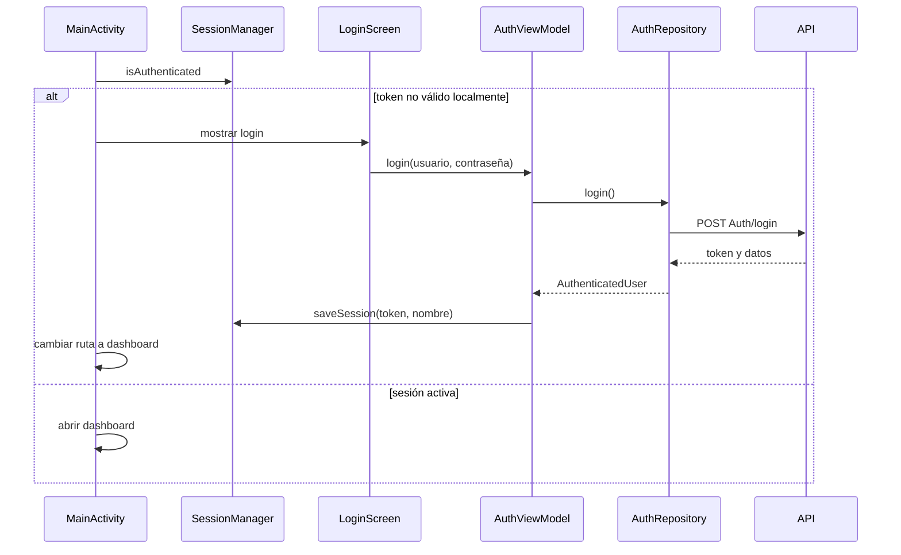
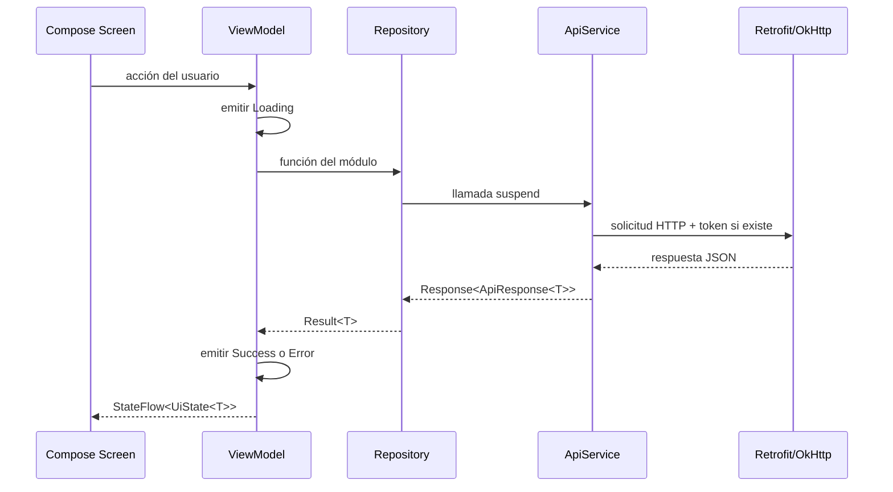

# Arquitectura técnica — HerreraSystemMobile

## 1. Propósito y alcance

HerreraSystemMobile es una aplicación Android nativa para la gestión administrativa de Sorbetería Herrera. La aplicación presenta módulos de inicio de sesión, dashboard, clientes, productos, reportes y usuarios. Los datos de negocio se consultan y modifican en una API REST; la app no mantiene una base de datos local de negocio.

Este documento refleja el código actual del repositorio. Distingue la arquitectura implementada de las mejoras sugeridas al final.

## 2. Tecnologías

| Área | Implementación |
|---|---|
| Lenguaje | Kotlin |
| Interfaz | Jetpack Compose y Material 3 |
| Arquitectura de pantalla | ViewModel + StateFlow + `UiState<T>` |
| Red | Retrofit, OkHttp y Gson |
| Concurrencia | Coroutines y `viewModelScope` |
| Sesión | `EncryptedSharedPreferences` y `MasterKey` |
| Imágenes de producto | Coil Compose |
| Navegación | Rutas de texto administradas en `MainActivity` |
| SDK | `compileSdk 35`, `targetSdk 35`, `minSdk 26` |
| Bytecode | Java 11 |

Las dependencias se declaran principalmente en `app/build.gradle.kts`. El proyecto también tiene `gradle/libs.versions.toml`; algunas versiones y plugins declarados allí no son la fuente que usa el módulo actualmente. Véase [Higiene técnica pendiente](#10-higiene-técnica-pendiente).

## 3. Mapa de carpetas

```text
HerreraSystemMobile/
├── app/
│   └── src/
│       ├── main/
│       │   ├── java/com/sistemas/herrerasystemmobile/
│       │   │   ├── MainActivity.kt             # Composición raíz y enrutamiento
│       │   │   ├── data/
│       │   │   │   ├── remote/
│       │   │   │   │   ├── api/ApiService.kt   # Contrato HTTP de Retrofit
│       │   │   │   │   ├── dto/                # Modelos JSON de entrada/salida
│       │   │   │   │   └── retrofit/           # Cliente HTTP e interceptor JWT
│       │   │   │   └── repository/             # Adaptación API → resultados usados por UI
│       │   │   ├── ui/
│       │   │   │   ├── auth/                   # Inicio de sesión
│       │   │   │   ├── catalogos/              # Pantalla de productos
│       │   │   │   ├── clients/                # Pantalla de clientes
│       │   │   │   ├── common/                 # Drawer y estado compartido
│       │   │   │   ├── dashboard/              # Pantalla de inicio
│       │   │   │   ├── reports/                # Pantalla de reportes
│       │   │   │   ├── theme/                  # Tema Compose, colores y tipografía
│       │   │   │   ├── users/                  # Pantalla de usuarios
│       │   │   │   └── viewmodel/              # ViewModels y modelos de UI
│       │   │   └── utils/SessionManager.kt      # Sesión cifrada y validación local JWT
│       │   ├── res/                            # Recursos Android/XML
│       │   └── AndroidManifest.xml
│       ├── test/                               # Pruebas unitarias
│       └── androidTest/                        # Pruebas instrumentadas
├── docs/ARCHITECTURE.md
├── gradle/                                    # Wrapper y catálogo de versiones
├── build.gradle.kts                           # Plugins de proyecto
└── settings.gradle.kts                        # Módulos y repositorios
```

### Responsabilidad de las capas

- **`ui`**: dibuja las pantallas, recoge acciones y representa `Loading`, `Success` y `Error`. No debería construir peticiones HTTP directamente.
- **`ui.viewmodel`**: mantiene estado observable, recibe acciones de pantalla, inicia corrutinas y coordina repositorios.
- **`data.repository`**: invoca `ApiService`, interpreta códigos HTTP y el contenedor `ApiResponse<T>`, y devuelve `Result<T>`.
- **`data.remote.api`**: define rutas, verbos, parámetros y tipos de respuesta Retrofit.
- **`data.remote.dto`**: refleja el JSON de la API. No es el estado visual de una pantalla.
- **`data.remote.retrofit`**: configura Retrofit/OkHttp y añade el token a las solicitudes.
- **`utils.SessionManager`**: conserva y expone los datos mínimos de la sesión.

Es una arquitectura por capas con MVVM en presentación. No es una implementación estricta de Clean Architecture: no hay capa `domain`, casos de uso ni interfaces de repositorio separadas de sus implementaciones.

## 4. Vista de dependencias



Los ViewModels publican `StateFlow<UiState<T>>`. Las pantallas reciben estado y callbacks, por lo que la UI puede representar resultados sin conocer Retrofit.

## 5. Arranque, autenticación y sesión

1. `MainActivity.onCreate` activa edge-to-edge y monta `HerreraSystemMobileTheme`.
2. Compose crea `SessionManager` y el servicio Retrofit.
3. El valor inicial de `isLogged` y `currentRoute` se basa en `SessionManager.isAuthenticated`.
4. Si el JWT no está guardado o no tiene formato/expiración aceptables, la ruta inicial es `login`.
5. `AuthViewModel.login` valida campos vacíos, llama `AuthRepository.login` y publica un `UiState`.
6. Al tener respuesta exitosa, el repositorio devuelve token y nombre visible. El ViewModel guarda la sesión cifrada.
7. `MainActivity` observa el estado de login y cambia a `dashboard` solo si existe una sesión aceptada.
8. `AuthInterceptor` añade `Authorization: Bearer <token>` a las peticiones cuando hay token.
9. Al cerrar sesión, `clearSession()` borra preferencias y la interfaz vuelve a login.

La comprobación local de JWT inspecciona la estructura y el campo `exp`; no valida la firma. La API es quien debe validar la firma y los permisos en cada operación protegida. La ausencia de `exp` se considera sesión inválida.

El login expone los roles como nombres; la sesión resuelve el rol de la aplicación a partir de esos nombres o de los claims de rol del JWT y conserva el ID de rol junto a la sesión cifrada. El ID `1` habilita las pantallas administrativas; el ID `2` corresponde al vendedor.



## 6. Navegación y composición

La navegación se mantiene en `MainActivity` con `currentRoute` y cadenas: `login`, `dashboard`, `clients`, `products`, `reports` y `usuarios`. `AppDrawerContent` envía una ruta al callback; `MainActivity` decide qué ViewModel cargar y qué pantalla renderizar. La barra inferior expone dashboard, clientes, productos y drawer.

Rutas disponibles en el drawer: Inicio, Clientes, Productos y Cerrar sesión para todos; Reportes y Usuarios se muestran únicamente al administrador (rol ID `1`). El vendedor (rol ID `2`) no ve esas dos opciones. `MainActivity` también bloquea esas rutas si se solicitan desde una ruta no permitida. La navegación visual no sustituye la autorización del servidor.

En pantallas con navegación propia, `onBack` devuelve al dashboard. La pantalla de Productos es un catálogo de consulta con búsqueda, filtros, tarjetas de estadísticas y lista desplazable; en esta aplicación no hay todavía un formulario para crear o editar productos.

Los ViewModels se construyen mediante `ViewModelProvider.Factory` locales en `MainActivity`. Esto funciona, pero hace que la Activity sea también el punto manual de composición de dependencias. No hay una librería de inyección de dependencias configurada.

## 7. Flujo de datos de un módulo



Los repositorios generalmente transforman una respuesta HTTP exitosa con `success=true` y `data` presente en `Result.success`. Los errores controlados se entregan como `Result.failure`; los ViewModels los convierten en `UiState.Error`. Las pantallas muestran carga, contenido o un error con reintento cuando está implementado.

## 8. Módulos y contratos de API

| Módulo | Presentación | ViewModel / repositorio | Endpoints usados |
|---|---|---|---|
| Autenticación | `LoginScreen` | `AuthViewModel` / `AuthRepository` | `POST Auth/login` |
| Dashboard | `AdminDashboardScreen` | `DashboardViewModel` / `DashboardRepository` | `GET Sales/stats`, `GET Sales` (fechas de hoy) |
| Productos | `ProductsScreen` | `ProductsViewModel` / `CatalogRepository` | `GET Products/catalog`, `GET Products/stats` |
| Clientes | `ClientsScreen` | `ClientsViewModel` / `ClientRepository` | `GET Customers`, `GET Customers/stats`, `GET Municipalities`, `GET/POST/PUT/DELETE Customers/{id}` |
| Usuarios | `UsersScreen` | `UsersViewModel` / `UserRepository` | `GET/POST Users`, `PUT Users/{id}`, acciones PATCH de estado y contraseña |
| Reportes | `ReportsScreen` | `ReportsViewModel` / `ReportRepository` | `Reports/sales-by-line-flavor`, `monthly-sales-trend`, `sales-by-geography`, `top-customers`, `sales-by-presentation` |

Las rutas se declaran en `ApiService`. El base URL está centralizado en `RetrofitClient`; `GsonConverterFactory` convierte JSON a DTOs. Listados paginados de productos y clientes se recorren en el repositorio hasta que `hasNextPage` es falso. El formulario de clientes muestra el nombre del municipio desde `GET /api/Municipalities`; al guardar usa el ID asociado a la selección para cumplir el DTO de la API.

### Dashboard: alcance real de las métricas

- `Sales/stats` entrega cantidad de ventas del mes, ingresos del mes y productos vendidos del mes.
- `Sales` se consulta con el rango del día actual en la zona `America/Managua`; el total diario se suma desde los registros recibidos.
- El ticket promedio presentado se calcula como ingresos mensuales / ventas mensuales.
- La API documentada no proporciona pedidos pendientes ni stock crítico. Por ello, pedidos pendientes se muestra como `N/D` y no se presenta una cifra simulada de stock.

## 9. Estado y convenciones de UI

`ui/common/UiState.kt` define un estado compartido:

```kotlin
sealed class UiState<out T> {
    object Loading : UiState<Nothing>()
    data class Success<T>(val data: T) : UiState<T>()
    data class Error(val message: String) : UiState<Nothing>()
}
```

Los ViewModels mantienen un `MutableStateFlow` privado y exponen el `StateFlow` de solo lectura. Algunas búsquedas usan debounce. `viewModelScope` cancela el trabajo al destruirse el ViewModel.

El tema global se encuentra en `ui/theme`. Los recursos y configuración de Android están bajo `app/src/main/res` y `AndroidManifest.xml`. Las pantallas principales usan insets de sistema para convivir con edge-to-edge.

## 10. Higiene técnica pendiente

El código está organizado por responsabilidad y las clases nuevas del dashboard siguen el flujo UI → ViewModel → repositorio → API. Hay oportunidades concretas para mantener la estructura coherente:

1. **Versiones duplicadas o desactualizadas**: el root `build.gradle.kts`, `app/build.gradle.kts` y `gradle/libs.versions.toml` declaran conjuntos de versiones distintos. Centralizar plugins y dependencias en el catálogo evitaría contradicciones.
2. **Dependencias sin uso aparente**: verificar si `navigation-compose` sigue siendo necesaria; las rutas actuales son estado manual y no usan `NavHost`.
3. **Punto de composición grande**: separar `AppNavigation`/`HerreraApp` de `MainActivity`, y mover factories a un contenedor de dependencias, reduciría responsabilidades en la Activity.
4. **Rutas como texto libre**: reemplazar cadenas por un `sealed class` o enum evitaría typos y centralizaría el mapa de pantallas.
5. **Paquete `catalogos`**: contiene específicamente la pantalla de productos; renombrarlo a `products` alinearía nombres de carpeta, pantalla y ruta.
6. **Consistencia de zona horaria**: dashboard usa Managua, mientras que el selector de años de reportes usa `LocalDate.now()` según la zona del dispositivo. Conviene unificar una política de fechas.
7. **Pruebas**: los archivos de prueba actuales son esqueletos. Conviene agregar pruebas unitarias a la validación de sesión, mapeo de errores y cálculos del dashboard, más pruebas instrumentadas de flujos críticos.
8. **Responsabilidad de DTOs**: mantener los DTOs de red separados de los modelos de presentación cuando las vistas acumulen reglas o campos derivados.

Estas mejoras no se aplicaron como parte de esta documentación para evitar una refactorización amplia no necesaria para explicar la arquitectura actual.

## 11. Compilar y verificar

En Windows PowerShell:

```powershell
.\gradlew.bat :app:compileDebugKotlin
```

Para generar APK de depuración usa `:app:assembleDebug`. Gradle debe poder usar el JDK de Android Studio y su caché local.

## 12. Glosario

- **DTO**: objeto Kotlin que representa campos de una petición o respuesta de red.
- **Repository**: capa que oculta el detalle HTTP al ViewModel y normaliza resultados.
- **ViewModel**: mantiene estado y lógica de presentación durante cambios de configuración.
- **StateFlow**: flujo observable de estado, adecuado para recolectar desde Compose.
- **JWT**: token firmado de autenticación enviado como Bearer en las solicitudes.
- **Edge-to-edge / insets**: dibujar detrás de las barras del sistema y aplicar el espacio seguro correspondiente.
